# CentOS 7 主机安全加固实验

> 实验环境：VMware Workstation + CentOS 7 虚拟机
> 实验目的：对Linux服务器进行安全基线加固，减少服务器被暴力破解、越权访问风险，完整记录加固操作、命令、加固前后对比与验证截图。

## 实验操作截图

### 一、网络连通性验证

查看网卡配置与IP地址、连通性测试
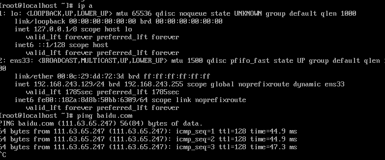

ping百度网络连通性测试结果
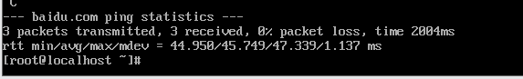

网卡IP地址配置详情
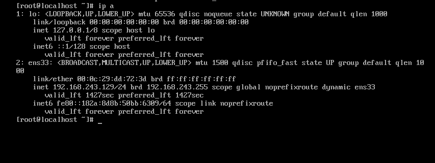

### 二、加固前基线采集

加固前系统监听端口
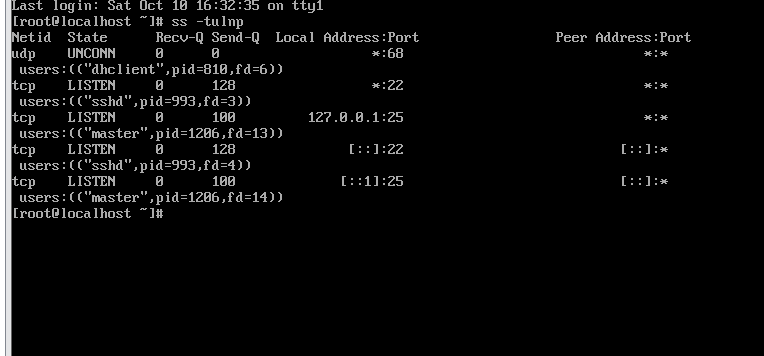

加固前系统账号列表 /etc/passwd
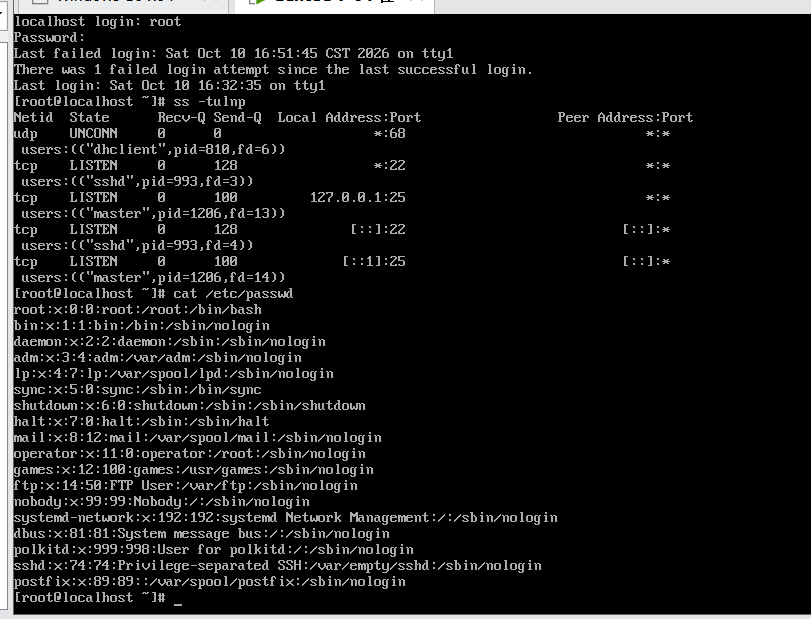

加固前密码影子文件 /etc/shadow
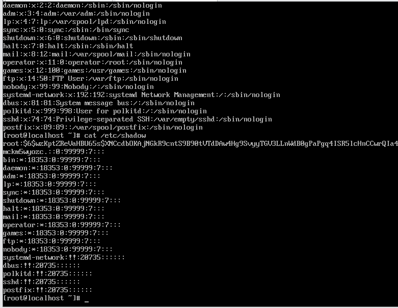

### 三、密码有效期策略加固

/etc/login.defs 配置文件全貌
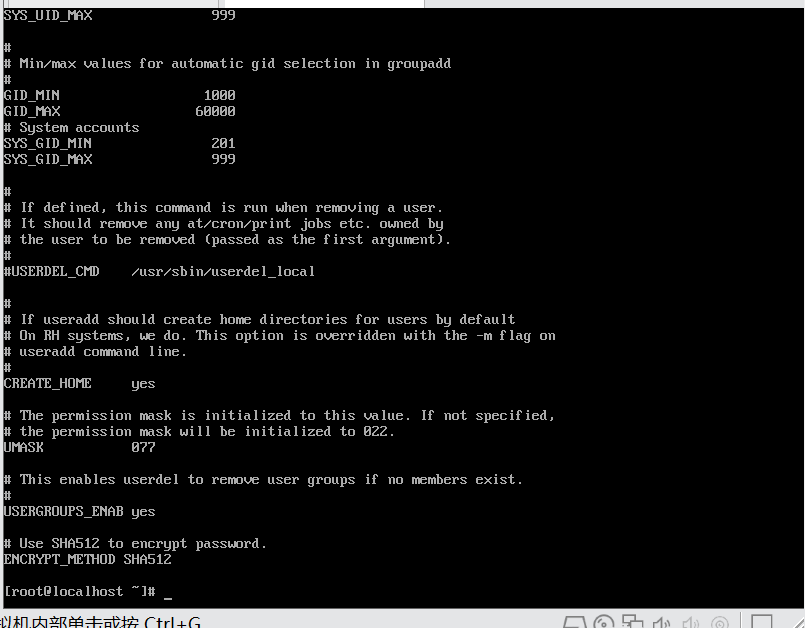

加固前原始密码策略（PASS_MAX_DAYS=99999）
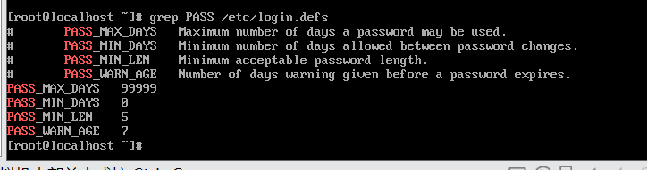

加固后密码策略（PASS_MAX_DAYS=90, PASS_MIN_LEN=8）
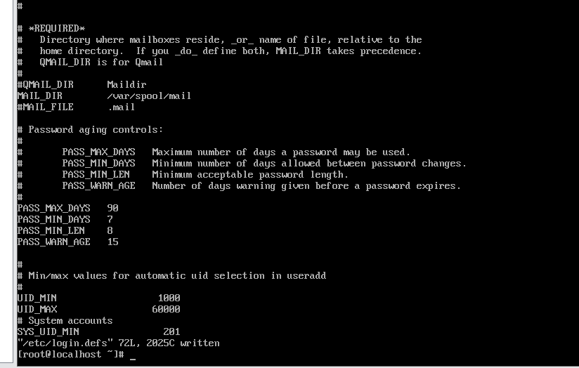

加固后grep验证策略生效
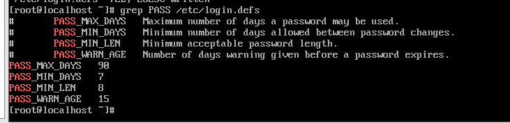

### 四、SSH安全加固：关闭root远程登录配置

修改sshd_config，禁止root远程SSH登录
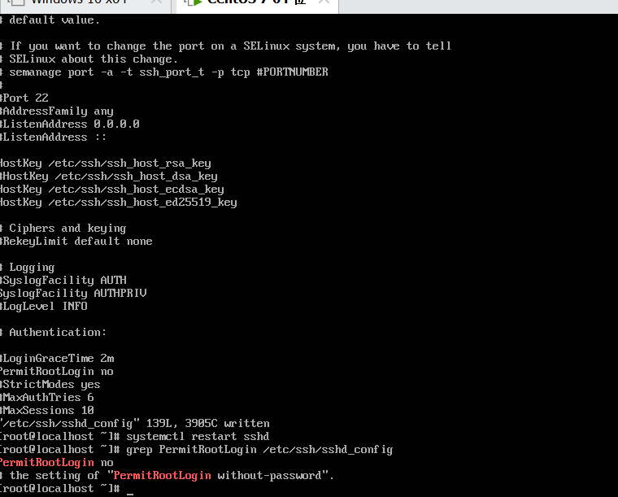

### 五、无用服务postfix加固

基线检查：postfix邮件服务初始运行状态
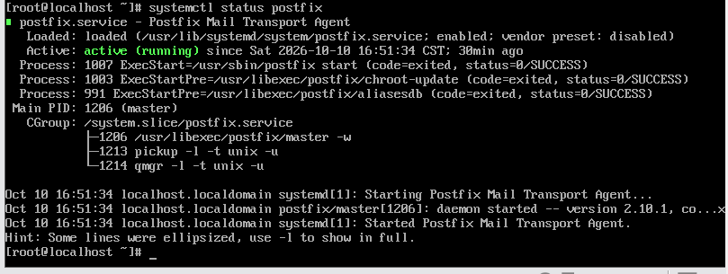

服务加固：停止并禁用postfix邮件服务
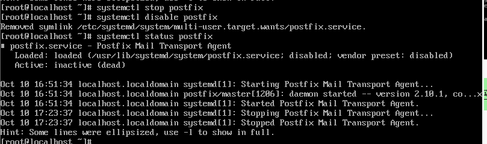

### 六、防火墙firewalld加固

防火墙加固：firewalld规则查看
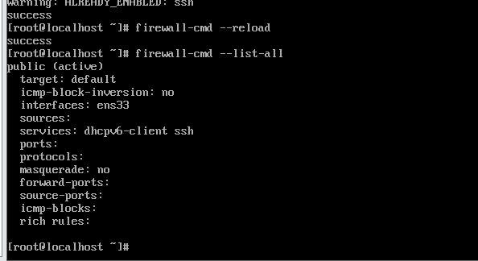

### 七、PAM密码复杂度加固

PAM加固：系统密码策略配置文件查看
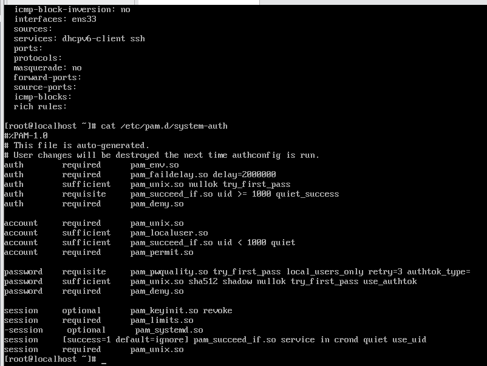

PAM加固：修改system-auth密码复杂度策略
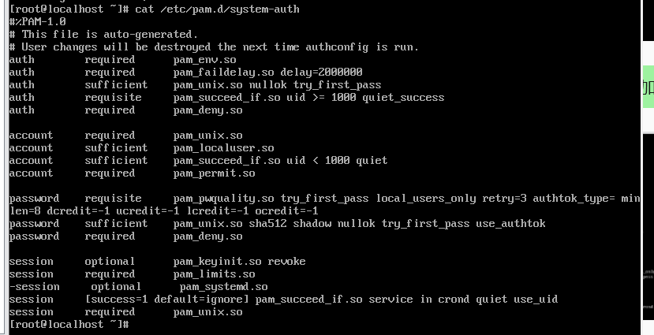

登录安全策略：密码有效期配置 login.defs
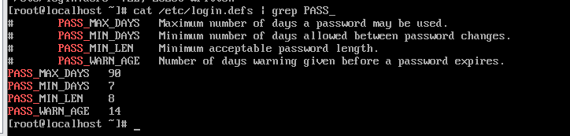

密码策略验证：新建用户测试密码复杂度
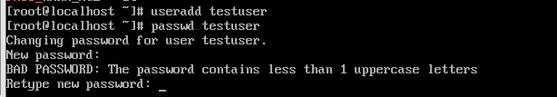

SSH加固：会话超时保活配置 ClientAlive
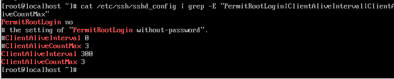

### 八、账户权限加固（PAM wheel限制su切换root）

查看postfix服务状态
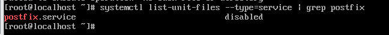

rsyslog日志服务启动与自启
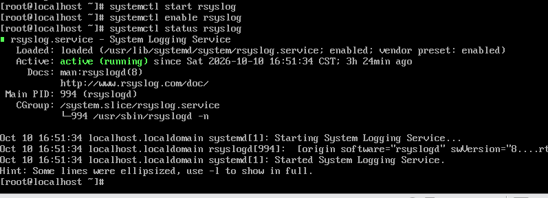

pam wheel配置su权限
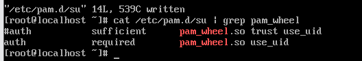

testuser切换root权限拒绝测试
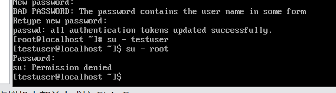

/etc/pam.d/su完整配置文件
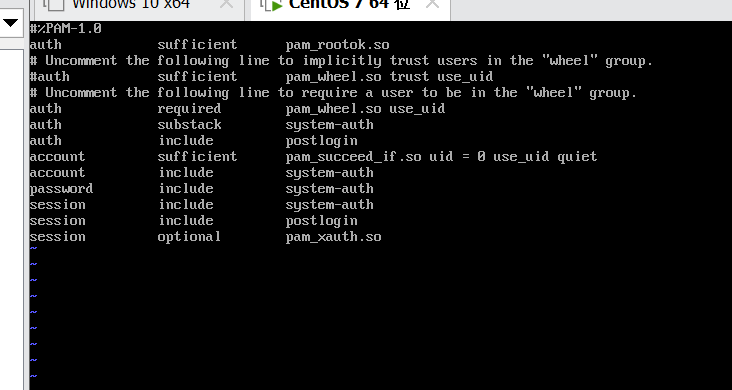

su切换root认证失败 & 登录失败日志
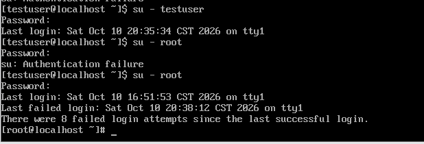

id查看用户组 + ss监听端口
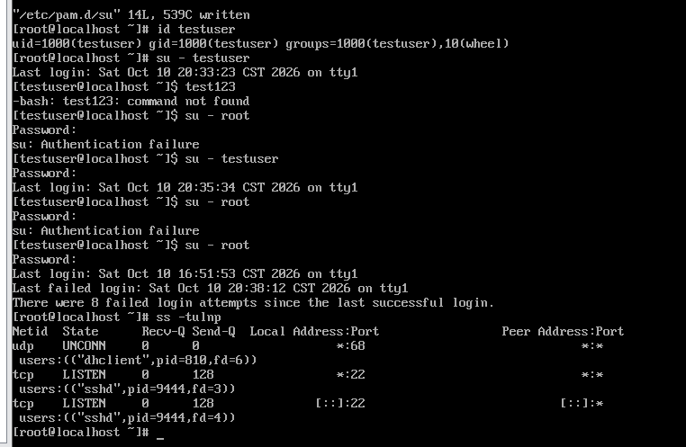

/etc/passwd 用户账户列表
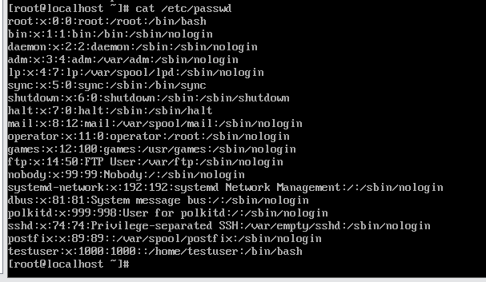

/etc/shadow 密码哈希文件
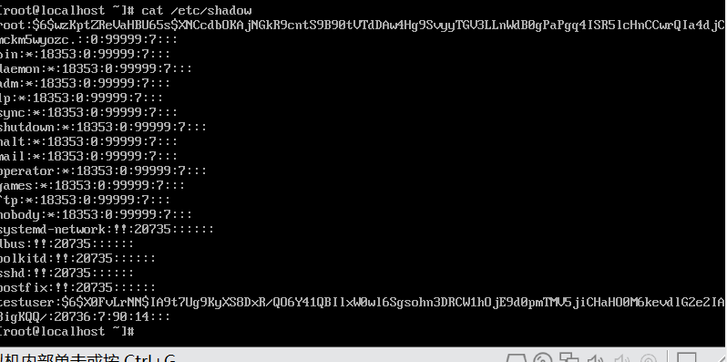

## 核心操作命令汇总

```bash
# ========== 网络基线检查 ==========
ip a
ping baidu.com
ss -tulnp
cat /etc/passwd
cat /etc/shadow

# ========== 密码有效期 login.defs ==========
vi /etc/login.defs
grep -E "PASS_MAX|PASS_MIN|PASS_WARN" /etc/login.defs

# ========== SSH安全加固 ==========
vi /etc/ssh/sshd_config
sshd -t
systemctl restart sshd

# ========== 无用服务 postfix ==========
systemctl status postfix
systemctl stop postfix
systemctl disable postfix

# ========== Firewalld防火墙 ==========
systemctl status firewalld
firewall-cmd --permanent --add-service=ssh
firewall-cmd --reload
firewall-cmd --list-all

# ========== PAM密码复杂度 ==========
vi /etc/pam.d/system-auth

# ========== 日志服务rsyslog ==========
systemctl start rsyslog
systemctl enable rsyslog
systemctl status rsyslog

# ========== PAM wheel限制su切换root ==========
vi /etc/pam.d/su
useradd testuser
passwd testuser
usermod -aG wheel testuser
id testuser
su - testuser
su - root
```

### 加固前后对比表

| 加固项目 | 加固前状态 | 加固后状态 |
| ---- | ---- | ---- |
| Root 远程 SSH 登录 | 允许 root 直接远程 SSH 登录 | 禁止 root 远程 SSH 登录 |
| su 切换 root 权限 | 所有知道密码的用户均可 su 到 root | 仅 wheel 组成员可以切换 root |
| Firewalld 防火墙 | 未开启 / 全部端口开放 | 仅放行 SSH 服务端口 |
| Postfix 邮件服务 | 默认开机自启，后台运行 | 停止服务，取消开机自启 |
| 密码策略 | 无密码复杂度、无过期限制 | 强密码策略 + 密码到期提醒 |
| 系统日志 | 日志服务未配置 | rsyslog 启用，记录登录审计日志 |
| 系统账号 | 存在多余无用账号 | 清理闲置账号，缩小攻击面 |
| 关键文件权限 | 文件权限宽松 | 最小权限，限制访问 shadow 等敏感文件 |

##  实验总结

本次实验在 CentOS7 虚拟机上完成主机安全基线加固，从网络基线采集、账号安全、SSH 会话、系统服务、防火墙、PAM 权限控制、日志审计多维度实施安全配置。遵循最小权限原则，有效降低暴力破解、账号越权、敏感配置泄露等安全风险。全部操作步骤、命令、加固前后基线数据均截图留存，可完整复现整个加固流程。
